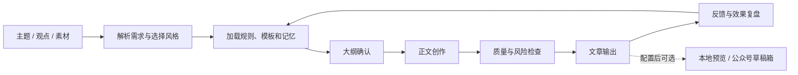

# wechatskill · 微信公众号 AI 写作 Skill

把主题、观点和素材，组织成适合公众号阅读的文章；让写作风格、素材积累与内容复盘形成持续的工作流程。

[](wechatskill/docs/USER_GUIDE.md)
[](wechatskill/SKILL.md)
[](wechatskill/scripts/)

**适合公众号作者、自媒体运营者，以及希望沉淀个人写作流程的内容团队。**

这是一个由写作指令、规则、模板、风格档案和辅助脚本组成的 Skill。文章创作由接入的 AI 助手完成，记忆更新依赖助手的文件读写能力；配图生成和公众号草稿上传需要另外配置 API。

**[快速开始](#快速开始) · [使用示例](#使用示例) · [脚本与配置](#脚本与配置) · [完整操作手册](wechatskill/docs/USER_GUIDE.md) · [工作流详解](wechatskill/WORKFLOW.md)**

## 能做什么

| 能力 | 内容 |
| --- | --- |
| 文章创作 | 干货、观点、故事、清单、热点；另含产品体验、工具分享、现象解读和调查实验模板 |
| 风格选择 | 内置温暖派、理性派、犀利派、khazix 派、梁靠谱、半佛仙人等风格档案 |
| 范文学习 | 拆解结构、语气、论证与排版，保存作者风格摘要；支持只学结构或只学文风 |
| 内容积累 | 管理选题、标题、素材、金句、读者画像与反馈；部分记忆库支持 CSV 导出 |
| 质量检查 | 提供原创度、AI 味、人味的规则评分，配合风险检查和人工核实 |
| 内容运营 | 效果数据复盘、对标账号分析、内容日历、评论区方案与关键词布局 |
| 多平台改写 | 将公众号文章改写为小红书笔记、知乎回答或短视频口播文案 |
| 成品处理 | Markdown、JSON、组合输出、公众号直贴文本；可选 HTML 预览和草稿箱上传 |

> 风格档案用于学习表达特征，不代表相关作者参与、授权或背书。质量评分是辅助编辑的启发式指标，不能证明文章原创、事实正确或一定通过平台审核。

## 工作方式



总控入口是 [`SKILL.md`](wechatskill/SKILL.md)，提示词位于 [`prompts/`](wechatskill/prompts/)，具体规则与模板按任务加载。素材与风格记忆保存在本地文件中。

## 快速开始

### 1. 获取文件

```bash
git clone https://github.com/zhuy3075-ui/wechatskill.git
cd wechatskill
```

也可以在仓库页面选择 **Code → Download ZIP**，解压后使用。

仓库内的 **`wechatskill/` 子目录才是完整 Skill**。安装时保留整个目录，确保 `SKILL.md` 与 `core/`、`rules/`、`styles/` 等资源保持相对位置。

### 2. 接入 AI 助手

**支持本地 Skill 的助手**：将整个 `wechatskill/` 子目录放入该助手的 Skill 目录，重新加载后确认可以读取 `SKILL.md`。

**Codex 本地目录示例**：`~/.codex/skills/wechatskill/`。Windows PowerShell 首次安装示例（在仓库根目录执行）：

```powershell
$skillDestination = Join-Path $env:USERPROFILE '.codex/skills/wechatskill'
if (Test-Path -LiteralPath $skillDestination) {
    throw '已存在同名 Skill，请先备份记忆、风格和配置，再决定如何更新。'
}
New-Item -ItemType Directory -Path (Split-Path $skillDestination -Parent) -Force | Out-Null
Copy-Item -LiteralPath './wechatskill' -Destination $skillDestination -Recurse
```

不同助手对 Skill 名称和调用命令的支持可能不同，以助手实际识别结果为准。

**只支持聊天提示词的工具**：使用 [`prompts/prompt.md`](wechatskill/prompts/prompt.md) 中对应任务的提示词，并按需附上模板、写作规范和风格档案。只粘贴提示词不会自动获得文件记忆、脚本执行或 API 上传能力。

### 3. 开始第一篇文章

```text
使用公众号写作 Skill，写一篇干货型公众号文章。
主题：普通人如何建立稳定的阅读习惯。
读者：工作繁忙、经常买书却读不完的上班族。
风格：理性派；约 1500 字。
请先给出大纲，确认后写正文，并检查事实来源与表达风险。
```

纯写作任务不需要微信公众号凭证或配图 API 密钥。辅助脚本也可以稍后再安装。

## 使用示例

自然语言是推荐入口。原 Skill 中的 `/wechat-writer` 是命令式示例，只有宿主助手支持相应命令映射时才能直接使用。

| 任务 | 示例指令 |
| --- | --- |
| 从素材出稿 | `把下面这些观点和案例写成一篇公众号观点文，先给大纲。` |
| 指定风格 | `用温暖派风格写一篇故事文，主题是第一次独自旅行。` |
| 推荐风格 | `先根据主题和素材推荐三个风格，说明理由。` |
| 学习范文 | `学习这篇范文，作者是……，只学结构，不保存未经授权的原文。` |
| 管理选题 | `从这些素材提取选题，去重后按优先级排序。` |
| 复盘效果 | `基于我提供的最近十篇文章数据做复盘，给出三个改进动作。` |
| 多平台改写 | `把这篇公众号文章改写成小红书笔记，保留核心观点。` |
| 输出格式 | `输出 Markdown 正文和结构化 JSON，并保留来源说明。` |
| 可选预览 | `生成公众号排版的本地 HTML 预览。` |
| 可选上传 | `将确认后的文章上传到公众号草稿箱。` |

完整命令、参数优先级和交互流程见 [Skill 入口](wechatskill/SKILL.md) 与 [用户操作手册](wechatskill/docs/USER_GUIDE.md)。

## 脚本与配置

### 运行环境

- 纯写作：需要可读取 Skill 内容的 AI 助手。
- Python 脚本：推荐 Python 3.10 或更高版本；从 **`wechatskill/` 子目录**执行，确保相对路径正确。
- 配图与公众号脚本：安装 [`requirements.txt`](requirements.txt) 中的依赖。`aiohttp` 用于配图的异步请求，原脚本在缺少它时可降级同步执行。
- `sync-to-local.sh`：面向 Linux、macOS 或 Windows Git Bash；不是 PowerShell 脚本。

从仓库根目录执行：

```bash
python -m pip install -r requirements.txt
cd wechatskill
```

以下命令均在 **Skill 子目录**执行：

```bash
# 查看风格清单
python scripts/style_recommender.py --list-only

# 推荐适合的风格
python scripts/style_recommender.py --content "AI 如何改变日常学习" --article-type 观点 --top-k 3

# 检查文章；article.md 与 source.md 替换为实际文件路径
python scripts/originality_quality_gate.py -a article.md -s source.md --strict-source-trace

# 导出成品；输出默认保存到 outputs/
python scripts/article_output_formatter.py -i article.md --mode both --style 理性派 --article-type 观点
```

质量闸门默认阈值：原创度 ≥ 70，AI 味 ≤ 30，人味 ≥ 60。原创度比较的有效性取决于参考来源是否充分；评分不代替查重、事实核实或人工审稿。

### 公众号草稿箱（可选）

先复制配置模板，再仅在本地填写真实凭证：

```powershell
Copy-Item -LiteralPath 'config/wechat.local.yaml.example' -Destination 'config/wechat.local.yaml'
```

填写 `appid`、`appsecret`，可选填写 `default_author`。账号还需具备相应接口权限，并满足微信侧 IP 白名单等要求；具体条件以当前公众号后台为准。

```bash
# 仅检查本地配置
python scripts/publish_wechat.py --validate

# 无需微信凭证的本地 HTML 预览
python scripts/publish_wechat.py --article article.md --title "文章标题" --preview

# 上传已确认内容到草稿箱；cover.jpg 替换为实际封面文件
python scripts/publish_wechat.py --article article.md --title "文章标题" --cover cover.jpg
```

脚本使用草稿箱接口，上传成功后需要在微信公众平台检查排版与图片，再决定是否正式发布。文件名为 `publish_wechat.py`，不代表运行它会自动群发文章。

### API 配图（可选）

```powershell
Copy-Item -LiteralPath 'config/image-gen.local.yaml.example' -Destination 'config/image-gen.local.yaml'
```

在本地配置中填写 `api_key`，并确认服务地址和模型可用。原脚本适配云雾 API；实际调用可能产生服务费用，仓库不提供 API 密钥。

```bash
python scripts/generate_images.py --validate
python scripts/generate_images.py --prompt "适合阅读习惯主题的简洁插画，无文字" --output cover.png
```

配置字段详解见 [`config/README.md`](wechatskill/config/README.md)。

## 仓库结构

```text
wechatskill/
├── README.md                  # 仓库首页与快速开始
├── requirements.txt           # 配图 / 公众号脚本依赖
├── .gitignore                 # 本地凭证、缓存、成品排除规则
└── wechatskill/                # 完整 Skill，安装时复制这个目录
    ├── SKILL.md                # 总控入口
    ├── README.md               # 原始完整功能说明
    ├── WORKFLOW.md             # 工作流与模块关系
    ├── core/                  # 写作人格、偏好与学习规则
    ├── rules/                 # 风格、排版、选题、风险、配图规则
    ├── templates/             # 九种文章模板
    ├── styles/                # 六个风格档案与说明
    ├── prompts/               # 可复用提示词与参考
    ├── memory/                # 素材、金句、标题、选题与反馈记忆
    ├── learning/              # 范文学习框架
    ├── examples/              # 文章示例
    ├── scripts/               # 评分、格式化、导出、配图、草稿上传
    ├── config/                # 空凭证模板与配置说明
    └── docs/                  # 用户手册、开发说明与技术参考
```

## 数据与更新

- 真实凭证只放在 `config/*.local.yaml`；本地配置、Token 缓存、文章输出和依赖缓存均由 `.gitignore` 排除。
- 内置素材与风格档案包含既有学习摘要和示例，使用前核实数据与来源，并遵守原作者权益。
- 更新前备份 `memory/`、`styles/`、`core/personality.md`、`core/self-evolution.md`、`learning/samples/` 和本地配置。首次安装命令会拒绝覆盖已有 Skill。
- 不要把未经授权的范文全文、客户资料或真实运营数据提交到公开仓库。

## 验证与维护

在 Skill 子目录中，可先运行不会调用外部 API 的检查：

```bash
python scripts/style_recommender.py --list-only
python scripts/originality_quality_gate.py --help
python scripts/article_output_formatter.py --help
```

规则变更只修改其职责所属文件，避免在 `SKILL.md` 和提示词中复制多份规则。回归场景与维护说明见 [开发文档](wechatskill/docs/README.dev.md)；本次仓库整理的实际验证范围见 [验证记录](docs/VERIFICATION.md)。

## 常见问题

**只复制 `SKILL.md` 可以吗？**

建议复制整个 Skill 目录。入口引用了规则、模板、风格和记忆文件，单独复制会缺少上下文。

**为什么输入 `/wechat-writer` 没有反应？**

宿主助手可能没有注册这个命令。改用自然语言，明确要求读取并使用公众号写作 Skill。

**安装 Skill 后能自动生成图片和上传公众号吗？**

需要助手具备脚本执行能力、安装对应 Python 依赖并配置有效 API 凭证。纯聊天环境只能按提示词协助创作。

**质量检查通过就可以发布吗？**

仍需人工核实事实、引用、版权和平台要求，并在公众号后台检查排版与图片。脚本评分只用于辅助编辑。

**为什么找不到脚本或配置文件？**

检查当前目录是否为包含 `SKILL.md` 的 `wechatskill/` 子目录。仓库根目录与 Skill 子目录相差一层。

## 反馈与贡献

欢迎通过 [Issues](https://github.com/zhuy3075-ui/wechatskill/issues) 提交文档问题、最小复现场景或改进建议。请说明使用环境、操作步骤、预期与实际结果；配置内容需先脱敏。

贡献时优先保持规则职责清晰，提供受影响流程的验证说明，并避免提交个人记忆、凭证和生成成品。

## 来源与许可证

本仓库从用户提供的 `wechatskill` 目录独立整理，保留原 Skill、规则、模板、风格档案与脚本；新增仓库首页、依赖清单和公开仓库忽略规则，并去除了学习摘要中的一处私人本地路径。

源目录未附带许可证，本仓库暂未指定开源许可证。公开可见不等于授予任意使用、修改或商业分发许可；相关权利以权利人的授权为准，第三方引用与示例的权利归各自权利人所有。
